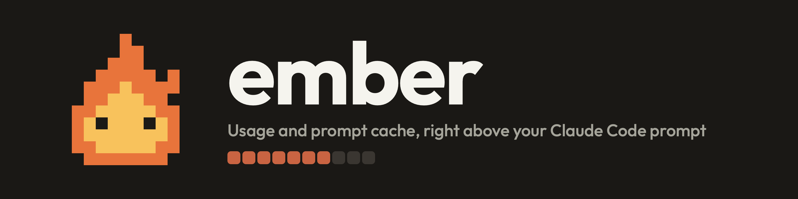
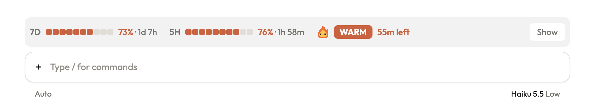
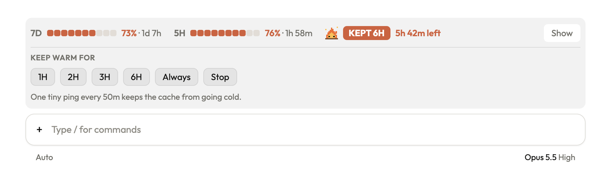
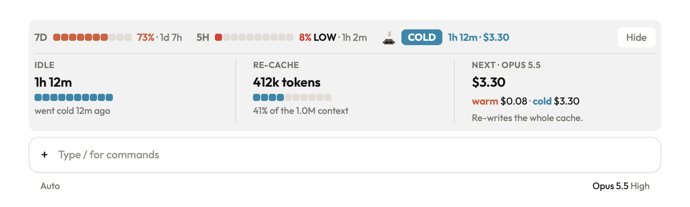
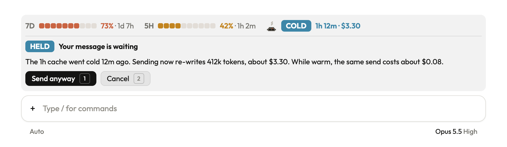
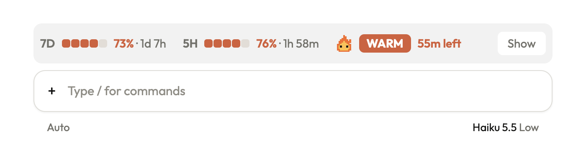
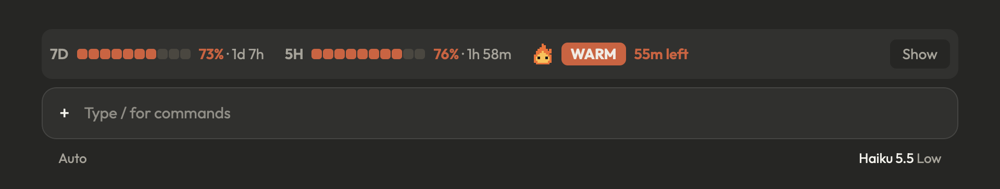

<p align="center">
  
</p>

# ember

A free mod for Claude Code. It adds a slim band above your prompt that shows:

- **How much usage you have left** in your 7-day and 5-hour windows, and when each one resets.
- **Whether your prompt cache is warm or cold**, how long it has left, and what your next message will cost.
- **A one-click way to keep the cache warm** while you step away, so coming back does not re-send the whole chat at full price.

And when the cache has gone cold on a big chat, it holds your next message and shows the price first, so you choose whether to pay it.

<p align="center">
  
</p>

## Install

The easy way: send this link to your agent and say "install this".

```
https://github.com/cyan119x/claude-code-ember
```

### For agents

If you are an agent and your user asked you to install this, run this in a shell:

```
claude plugin install ember --marketplace cyan119x/claude-code-ember
```

It installs for the user (all their projects). Then tell your user: "Ember is installed. Start a new session to see the band above your prompt." Do not edit their settings file by hand.

### By hand

In a Claude Code terminal session, type:

```
/plugin install ember --marketplace cyan119x/claude-code-ember
```

1. Type `y` when it asks `Add marketplace?`.
2. Pick the **user** scope with Enter.
3. Start a new session.

In the desktop app, where `/plugin` does not run: click **+** next to the prompt box, then **Plugins**, **Add marketplace** with `cyan119x/claude-code-ember`, then **Add plugin**.

Ember needs a Claude Code build with mods (function hooks). It was built and tested on Claude Code 2.1.309.

## What you see

### Usage left

**7D** is your 7-day window, **5H** your 5-hour window. Ten squares show what is **left**, not what is used, with the percent and the time until it resets. The colour follows what is left: clay from 50%, amber under 50%, red under 15%, where a bold **LOW** appears.

### The flame

A small pixel flame tells the cache's state at a glance. It dances while the cache is warm, burns low in its last 10 minutes, sleeps as a smoking coal once it is cold, and sits on a log with sparks while Ember keeps it warm for you.

### The tag

Next to the flame:

- **WARM** with the minutes left before the cache goes cold.
- **KEPT 6H** (or **KEPT ∞**) while Keep warm holds it, with the time left in that window.
- **COLD** with how long you have been away and what the next message costs to re-write the cache.
- **NEW** in a chat that has not sent its first message yet, and **SUMMARY** right after Claude Code compacts a long chat into a summary: the next turn writes a fresh, small cache, so neither counts as going cold.

Click the tag to open **Keep warm**: 1H, 2H, 3H, 6H, Always, and Stop. One click starts it; there is nothing to type.

<p align="center">
  
</p>

### The card

Click **Show** to open it and **Hide** to fold it. Warm starts folded; cold opens by itself so you see the price before you send. It shows how long you have been idle, how many tokens sit in the cache and their share of the context window, and what the next message costs on your model, warm and cold side by side.

<p align="center">
  
</p>

### The held send

When the cache is cold and the chat holds 50k tokens or more, Ember holds your message at the band. It tells you what sending now costs against what it would have cost warm, then waits: **Send anyway** (key 1) sends your words as they are, **Cancel** (key 2) puts them back in the prompt box. Prefer a warning only? Run `/ember guard warn`.

<p align="center">
  
</p>

### Fits any width

Wide, everything sits on one row. As the band narrows, the ten squares become five, then the reset times go, then the squares; past that, usage takes a row of its own. The form follows the band's width, not the clock: a minute ticking from 1h left to 59m left never changes it. Light and dark mode both have their own colours.

<p align="center">
  
</p>

<p align="center">
  
</p>

## Commands

| Command | What it does |
| --- | --- |
| `/keepwarm` | Keep the cache warm for 6 hours |
| `/keepwarm 90m` | Keep it warm for a window you choose |
| `/keepwarm always` | Keep it warm after every turn, in every session |
| `/keepwarm off` | Stop |
| `/keepwarm status` | Time left and the next ping |
| `/ember` | Cache state, cold price, Keep warm, and the cold writes paid this session |
| `/ember guard warn` / `/ember guard ask` | Only warn about a cold send, or hold it (the default) |

## How Keep warm works, and what it costs

The prompt cache lives for one hour after its last use. Keep warm sends one tiny request every 50 minutes, branched off your chat, so the cache is read and its hour starts again. A read costs about a tenth of a normal input token, so a ping costs cents where a cold re-write of a large chat costs dollars. `/ember` shows how many pings equal one cold write.

Pings stop when the window ends, when you run `/keepwarm off`, or as soon as a ping finds the cache already gone. A chat on a 5-minute cache gets no pings: they would have to run every few minutes.

## Good to know

- **Prices are estimates.** They come from the price table in `hooks/register.ts` (`PRICES`), not from your bill. If prices change, edit that table.
- **Subagents do not count.** Only your main chat resets the cache clock.
- **Apart from Keep warm, it never calls a model.** The band only reads the app's own numbers and draws them.
- **It survives reloads.** After `/reload-plugins` the band comes back with the cache's state, not just usage.
- **Where it draws.** The desktop app gets the full band. A terminal gets the same facts as text. VS Code and mobile show Keep warm on the status line.
- **Other band mods.** Ember sits nearest the prompt when other mods also draw above it.

## What is inside

```
claude-code-ember/
├── .claude-plugin/
│   ├── plugin.json         the mod's name and version
│   └── marketplace.json    makes this repo installable
├── hooks/
│   ├── hooks.json          points to the module
│   ├── register.ts         the band, cache tracking, Keep warm, the held send, commands
│   ├── outfit-metrics.ts   Outfit's glyph widths, so drawn text fits exactly
│   └── font.ts             Outfit, embedded so the drawings render anywhere
├── tests/register.test.ts  182 tests
└── assets/                 banner and illustrations
```

The images in `assets/` are illustrations drawn with the mod's own type, colours and pixel art, not screenshots of the app; the numbers in them are examples.

## Remove it

```
claude plugin uninstall ember
```

## Develop it

Load the folder without installing it:

```
claude --plugin-dir ./claude-code-ember
```

Run the tests:

```
claude plugin test ./claude-code-ember
```

## Credits and license

[MIT](LICENSE). Ember grew from two MIT projects: [cache-tax](https://github.com/karanb192/cache-tax) by Karan Bansal, which gave it the cache clock, the cold-send guard and Keep warm, and [ribbon](https://github.com/robonuggets/ribbon) by Jay E (RoboNuggets), which gave it the band and its look.

The embedded font is [Outfit](https://github.com/Outfitio/Outfit-Fonts), under the SIL Open Font License 1.1.

Made by [cyan119x](https://github.com/cyan119x).
